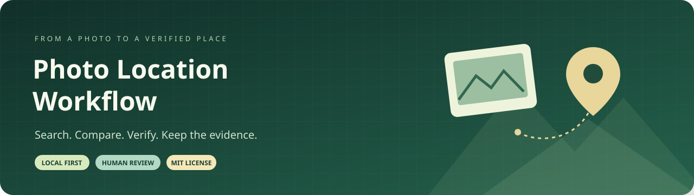
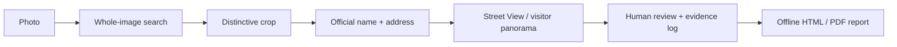
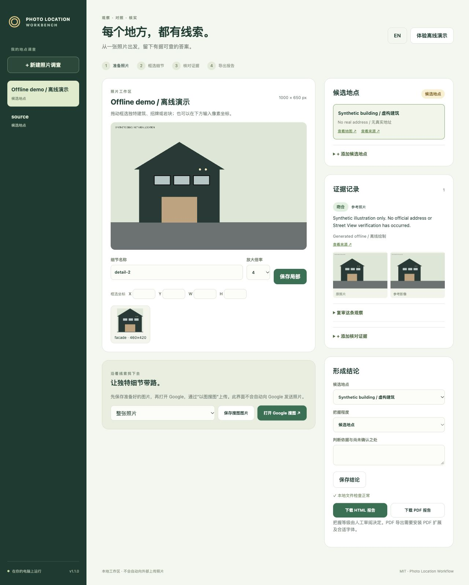
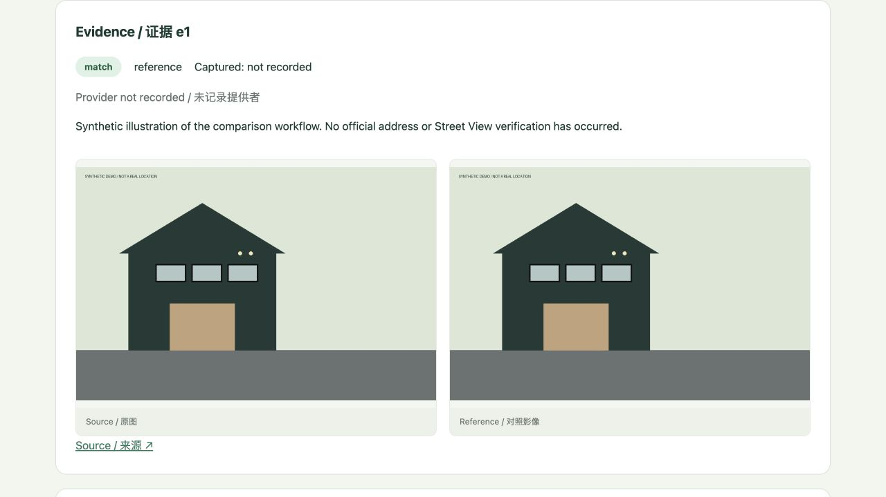

<p align="center">
  
</p>
<p align="center">
  <a href="https://github.com/xudaniel/photo-location-workflow/actions/workflows/tests.yml"></a>
  <a href="https://github.com/xudaniel/photo-location-workflow/releases"></a>
  
  <a href="LICENSE"></a>
</p>
<p align="center"><strong>English</strong> · <a href="README.zh-CN.md">简体中文</a><br>
<a href="#quick-start">Quick start</a> · <a href="docs/commands.md">Command reference</a> · <a href="docs/case-studies.md">Case studies</a> · <a href="CHANGELOG.md">Changelog</a></p>

# A place. A trail of evidence.

**Photo Location Workflow** turns photo-location research into a repeatable, reviewable process: reverse-image search, distinctive-detail crops, authoritative address checks, Street View comparisons, and an evidence report.

The local bilingual web workbench and CLI share preparation, records, integrity checks, and reports. **You or your AI assistant make the visual judgments.** It does not run a geolocation model, automatically identify landmarks, or treat a search suggestion as a verified answer. No model API key is required.



## What you get

| Capability | What it does |
| --- | --- |
| Local web workbench | Drag/drop photos, draw crops, switch English/Chinese, compare evidence images, and download reports. |
| Image preparation | Corrects EXIF orientation, strips metadata, preserves the input file, and records checksums. |
| Distinctive crops | Saves native-resolution crops and nearest-neighbor enlargements in isolated directories. |
| Google Lens assistance | Prints manual instructions by default; optional `--upload` uses a visible, disposable Chromium session. |
| Structured evidence | Records candidates, addresses, source URLs, capture months, providers, matches, uncertainty, and contradictions. |
| Review history | Revises a verdict with a mandatory explanation while retaining the previous judgment. |
| Integrity checks | Detects missing or changed assets, unsafe paths, and broken candidate references. |
| Confidence requirements | Requires documented address and visual evidence before accepting stronger conclusions. |
| Comparison reports | Builds self-contained HTML and CJK-capable PDFs with source links, paired images, and review history. |

## Local workbench



After installing, run `photo-locate ui`. Click **Try offline demo** to explore without uploading a photo or setting up a key.

## Report preview

The paired-image view below is generated from the offline synthetic demo, not a real location identification.



## Quick start

### Install v1.1.0 from source

Requires **Python 3.10+**. CI covers Ubuntu with Python 3.10, 3.12, and 3.13, plus macOS 15 and Windows 2025 with Python 3.12.

```bash
git clone --branch v1.1.0 https://github.com/xudaniel/photo-location-workflow.git
cd photo-location-workflow
python3 -m venv .venv
source .venv/bin/activate
python -m pip install --upgrade pip
python -m pip install -e '.[pdf]'
```

On Windows PowerShell, use `python -m venv .venv` and `.venv\Scripts\Activate.ps1`. For HTML only, install with `python -m pip install -e .`.

Alternatively, download the wheel from [Releases](https://github.com/xudaniel/photo-location-workflow/releases/latest) and run `python -m pip install /path/to/photo_location_workflow-1.1.0-py3-none-any.whl`. This project is distributed on GitHub; a PyPI publication is not required for these installation methods.

### Open the local workbench

```bash
photo-locate ui
```

1. Drop or choose a photo, draw a rectangle around a distinctive detail, and save the crop.
2. Save the search image, open Google Lens separately, upload manually, and record candidates and authoritative addresses.
3. Add sources, capture months, providers and reference images. Review matches and contradictions with paired images.
4. Preserve review reasons, save a conclusion, and download HTML or PDF.

The workbench listens only on `127.0.0.1` and uses the same `case.json` and validation rules as the CLI. No Node, frontend build or model key is needed. Use `--cases` to choose a case directory, `--port` to change the port, or `--no-open` to skip opening a browser. Avoid editing the same case from another process while it runs. Press Ctrl-C to stop; reopen it later to continue.

### Try it without uploading a photo

Click **Try offline demo** in the workbench, or run:

```bash
photo-locate demo --case cases/demo-v1
photo-locate check cases/demo-v1
photo-locate report cases/demo-v1
```

Open `cases/demo-v1/report.html` in a browser. The demo draws a **fictional building**, runs entirely offline, and leaves the conclusion at `candidate`. Choose a new empty case directory when rerunning. The installed wheel includes the demo and web assets. No private photographs or third-party map images are bundled.

## A complete investigation

### 1 · Prepare the image and search the whole scene

```bash
photo-locate init /path/to/photo.jpg --case cases/trip
photo-locate lens cases/trip
```

`init` writes an orientation-normalized, metadata-free PNG copy and records the original file's SHA-256. It does not copy your absolute source path into the investigation record. `lens` prints the prepared file and Google URL; it does **not** upload by default.

For the optional visible-browser assistant:

```bash
python -m pip install -e '.[browser]'
playwright install chromium
photo-locate lens cases/trip --upload
```

`--upload` sends the selected prepared image to Google. Inspect the results and press Enter in the interactive terminal to save a local capture and visible links. Login, consent screens, CAPTCHAs, or changed controls may require your manual action. The assistant does not bypass them or call an undocumented Lens API. Manual Google Lens upload remains available.

### 2 · Search a distinctive crop

Windows, signs, entrances, unusual rocks, and waterfall crests are often more useful than generic scenery. Replace these example coordinates with your own:

```bash
photo-locate crop cases/trip --box 0,100,200,300 --label facade --scale 4
photo-locate lens cases/trip --asset assets/crops/facade/native.png --upload
```

Coordinates are `x,y,width,height` in the **orientation-corrected copy**. The CLI returns native and enlarged image paths. Enlargement reveals the existing pixels; it cannot reconstruct unreadable signs or license plates. A vehicle's registration location does not establish the shooting location.

### 3 · Record a candidate and verify its address

The following commands illustrate a public landmark. Record an `official` match only after actually checking the cited page for your investigation.

```bash
photo-locate candidate cases/trip \
  --name '銚子大滝 / Chōshi Ōtaki' \
  --address '青森県十和田市大字奥瀬字奥入瀬' \
  --url 'https://www.tohokukanko.jp/attractions/detail_1573.html'

photo-locate evidence cases/trip --candidate c1 --kind official \
  --url 'https://www.tohokukanko.jp/attractions/detail_1573.html' \
  --verdict match --notes 'Checked the landmark name and address on the official tourism page.'
```

The candidate record includes an encoded Google Maps link. Source classifications and observations are supplied by the reviewer; the CLI does not authenticate a website's claims.

### 4 · Compare Street View or a visitor panorama

Open the candidate in Google Maps and select **Street View & 360°**. Match stable details: window groups, lights, entrances, road direction, retaining walls, signs, mountain profiles, or exposed rock layers. Distinguish official road imagery from visitor-uploaded panoramas.

Replace the URL, capture month, screenshot, and notes below with the material you actually inspected:

```bash
photo-locate evidence cases/trip --candidate c1 --kind streetview \
  --url 'https://www.google.com/maps/YOUR_OBSERVED_VIEW' \
  --captured 2018-10 --provider 'Visitor 360 panorama; contributor name' \
  --image /path/to/observed-view.png --verdict match \
  --notes 'The central crest rock, right-side layered wall, and left-bank tree positions align.'
```

Use `--captured unknown` if no capture month is visible. Use `unclear` when details are inconclusive, or `contradiction` when they conflict. The CLI imports a metadata-free copy of the screenshot and records its checksum.

### 5 · Review, check, and conclude

If new evidence changes a judgment, preserve the earlier verdict:

```bash
photo-locate review cases/trip --evidence e2 --verdict unclear \
  --reason 'The viewpoint is too distant to verify the rock detail.'
photo-locate check cases/trip
```

After the required evidence is actually in place:

```bash
photo-locate conclude cases/trip --candidate c1 --level confirmed \
  --note 'Official address and reviewed panorama agree; exact camera position is unmeasured.'
photo-locate report cases/trip
photo-locate report cases/trip --format pdf
```

A revision or new observation resets the conclusion to `candidate`. The example `unclear` revision above must be resolved through a further documented review or another matching panorama before that evidence supports `confirmed`.

## Confidence is a review label

| Level | Requirements enforced by the CLI |
| --- | --- |
| `unknown` | No settled identification. |
| `candidate` | A working hypothesis. |
| `high` | Matching official-address record + attached matching visual evidence + valid local assets + no unresolved contradictions. |
| `confirmed` | All `high` requirements, plus a matching, attached Street View/360 record. |

These checks enforce the **shape and completeness of the evidence record**, not the truth of the reviewer's statements. SHA-256 detects file changes; it does not prove that an image is authentic. Unsupported details should remain unresolved. If no panorama exists, retain `high` or a lower label and explain the limit.

## Reports and fonts

- **HTML:** self-contained, responsive, offline, printable; includes paired images, evidence labels, provider/date information, and review history.
- **PDF:** paired images, clickable sources, CJK text, crop appendices, and embedded TrueType fonts. Requires the `pdf` extra.
- **Font detection:** common macOS Arial Unicode, Linux WenQuanYi, and Windows Microsoft YaHei paths. If necessary, pass `--font-path /path/to/font.ttf` or `.ttc`. On Ubuntu/Debian, `fonts-wqy-microhei` supplies a suitable font. Your chosen font must cover the characters in your report.
- **Output:** defaults to `report.html` or `report.pdf` inside the case. `--output` creates parent directories; exporting into the investigation's asset directory or to a mismatched file extension is rejected.

Open exported PDFs before sharing to verify layout and glyphs. Reports contain the images, notes, and URLs you attach.

## Local data and privacy

```text
cases/trip/
├── case.json                    # candidates, evidence, judgments, checksums
├── assets/
│   ├── source.png               # metadata-free, orientation-normalized copy
│   ├── crops/facade/            # native.png + pixels.png
│   └── evidence/e1.png          # imported reference image, when attached
├── report.html
└── report.pdf
```

The code does not read `.env`, require paid model keys, or reuse your normal browser profile. Search captures and investigations stay local unless you upload or share them. Metadata removal does **not** redact visible faces, plates, or text. `.gitignore` excludes common investigation/output folders and raster/PDF files; it is a convenience, not a universal privacy guarantee for arbitrary custom paths.

This project targets public landmarks and scene comparison. It does not identify people, recover blurred text, or infer a private person's current whereabouts.

## Compatibility and limitations

- Existing **0.1.0 schema-v1 cases remain readable**. Legacy assets without stored checksums produce warnings; no retroactive integrity claim is made. New files use isolated crop/evidence directories.
- Mutate a given case from **one process at a time**; the JSON store is not a concurrent database.
- Google interfaces and Lens session links can change or expire. Browser automation is best-effort, requires a display and interactive terminal, and is not a live-Google CI test.
- Street View coverage varies. Dates are reviewer-entered; Google AI summaries and result rankings are clues, not verification.

## Development

```bash
uv sync --locked --extra dev --extra pdf --extra release
uv run --locked --extra dev --extra pdf pytest -q
uv run --locked --extra release python -m build
uv run --locked --extra release python -m twine check dist/*.whl dist/*.tar.gz
```

CI checks the test matrix, builds wheel/source distributions, validates package metadata, and smoke-tests the installed wheel. Tests use synthetic images, not live Google services. See [CONTRIBUTING](CONTRIBUTING.md), the [full command reference](docs/commands.md), [agent workflow](docs/agent-workflow.md), and [public case studies](docs/case-studies.md).

## Reproducible development and releases

`uv.lock` pins dependencies; `--locked` rejects an outdated lockfile. CI tests synthetic cases across three operating systems and checks a separately installed wheel, including its demo and web assets. Linux CI requires the CJK PDF test; other systems explicitly skip it when a suitable font is absent.

Pushing a `vX.Y.Z` tag matching the package version triggers the release workflow. It runs the full CI suite before building the wheel, source archive and SHA-256 manifest and publishing a GitHub Release. See [CONTRIBUTING](CONTRIBUTING.md) for the release procedure. Bilingual issue forms and a PR template are included.

## License and credits

Code and original documentation are released under the **[MIT License](LICENSE)**, © 2026 Daniel Xu. Third-party photos, fonts, map imagery, and trademarks retain their owners' rights. Google Lens and Google Maps are not affiliated with this project. Browser integration uses the documented [Playwright file-upload API](https://playwright.dev/python/docs/input#upload-files).
