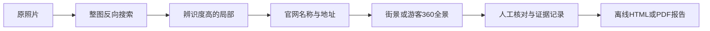

<p align="center"></p>
<p align="center">
<a href="https://github.com/xudaniel/photo-location-workflow/actions/workflows/tests.yml"></a>
<a href="https://github.com/xudaniel/photo-location-workflow/releases"></a>

<a href="LICENSE"></a>
</p>
<p align="center"><a href="README.md">English</a> · <strong>简体中文</strong><br>
<a href="#快速开始">快速开始</a> · <a href="docs/commands.md">命令手册</a> · <a href="docs/case-studies.md">真实案例</a> · <a href="CHANGELOG.md">更新记录</a></p>

# 找到地点，也留下依据。

**Photo Location Workflow** 把照片定位研究整理成一条可复核的流程：整图反向搜索、独特局部裁切、官网地址核对、街景对照，以及证据报告。

命令行工具负责图片准备、记录、文件完整性检查与报告。**视觉判断由你或连接工具的 AI 助手完成**；程序本身没有地理识别模型，不会把相似搜索结果直接当成答案，也不需要付费模型 API 密钥。



## 功能一览

| 功能 | 作用 |
| --- | --- |
| 图片准备 | 校正 EXIF 方向、移除元数据、保留输入文件、记录校验和。 |
| 独特局部裁切 | 保存原始分辨率裁切及最近邻放大图，使用独立目录防止覆盖原图。 |
| Google Lens 辅助 | 默认只显示手动操作说明；显式加 `--upload` 后使用可见、临时 Chromium 会话。 |
| 结构化证据 | 记录候选、地址、来源、拍摄月份、提供者、匹配、不确定与反例。 |
| 保留复审历史 | 修订判断时必须说明理由，旧判断仍保留。 |
| 完整性检查 | 发现文件缺失、内容变化、越界路径和无效候选引用。 |
| 结论等级约束 | 记录官网地址和视觉证据后，才允许采用较高把握等级。 |
| 双图对比报告 | 导出可离线查看的 HTML 和支持中文的 PDF，附来源、并排图片及复审记录。 |

## 报告预览

下图来自离线虚构建筑演示，仅展示双图版式，不代表真实地点识别。


## 快速开始

### 安装 v1.0.0

需要 **Python 3.10+**。代码适用于 macOS、Linux 和 Windows；CI 在 Ubuntu 的 Python 3.10、3.12、3.13 上运行。

```bash
git clone --branch v1.0.0 https://github.com/xudaniel/photo-location-workflow.git
cd photo-location-workflow
python3 -m venv .venv
source .venv/bin/activate
python -m pip install --upgrade pip
python -m pip install -e '.[pdf]'
```

Windows PowerShell 使用 `python -m venv .venv` 和 `.venv\Scripts\Activate.ps1`。只需要 HTML 时，执行 `python -m pip install -e .` 即可。

也可以从 [Releases](https://github.com/xudaniel/photo-location-workflow/releases/latest) 下载 wheel，执行 `python -m pip install /path/to/photo_location_workflow-1.0.0-py3-none-any.whl`。上述方式直接从 GitHub 安装，不依赖 PyPI 发布。

### 不上传照片，先跑一个离线演示

```bash
python examples/synthetic_demo.py --case cases/demo-v1
photo-locate check cases/demo-v1
photo-locate report cases/demo-v1
```

用浏览器打开 `cases/demo-v1/report.html`。演示采用程序绘制的**虚构建筑**，全程离线，结论保留为候选。再次运行时选择新的空目录。仓库不附私人原照片或第三方地图影像。

## 一次完整调查

### 1 · 准备图片并搜索整张场景

```bash
photo-locate init /path/to/photo.jpg --case cases/trip
photo-locate lens cases/trip
```

`init` 保存方向已校正、移除元数据的无损 PNG 副本，并记录原文件的 SHA-256。调查记录不保存原图的绝对路径。`lens` 显示准备好的文件路径和 Google 地址，默认**不上传**。

如需可选的浏览器辅助上传：

```bash
python -m pip install -e '.[browser]'
playwright install chromium
photo-locate lens cases/trip --upload
```

`--upload` 会把选定的副本发送给 Google。请在可见浏览器中检查结果，再回交互终端按 Enter，程序保存本地截图及可见链接。遇到登录、同意弹窗、验证码或界面变化，由你手动处理或停止；程序不绕过验证码，也不调用未经公开的 Lens 接口。手动上传始终是备用方式。

### 2 · 搜索辨识度最高的局部

窗组、招牌、入口、特殊岩块和瀑顶通常比普通森林更有价值。以下坐标仅作语法示例，请按自己的图片调整：

```bash
photo-locate crop cases/trip --box 0,100,200,300 --label facade --scale 4
photo-locate lens cases/trip --asset assets/crops/facade/native.png --upload
```

坐标是**校正方向后副本**中的 `x,y,width,height`。命令返回原始裁切和放大图路径。放大只展示已有像素，不能恢复模糊路牌和车牌；车辆登记地也不能证明拍摄地。

### 3 · 记录候选并核对官网地址

下面用公开景点演示。只有实际查看了对应页面、确认信息后，才应为自己的调查记录 `official` 匹配。

```bash
photo-locate candidate cases/trip \
  --name '銚子大滝 / Chōshi Ōtaki' \
  --address '青森県十和田市大字奥瀬字奥入瀬' \
  --url 'https://www.tohokukanko.jp/attractions/detail_1573.html'

photo-locate evidence cases/trip --candidate c1 --kind official \
  --url 'https://www.tohokukanko.jp/attractions/detail_1573.html' \
  --verdict match --notes '已在官方旅游页面核对景点名称及所在地。'
```

候选记录包含已编码的 Google 地图链接。来源分类、页面内容与匹配判断均由审阅者提供；工具不能自动证明网站上的说法真实。

### 4 · 核对街景或游客全景

在 Google 地图选择 **Street View & 360°**。优先比较稳定特征：窗组、灯、门框、道路走向、挡墙、路牌、山形、岩壁层理。区分 Google 官方道路街景与游客上传的全景，也要记录影像月份。

将下例的链接、月份、截图和备注替换为你实际查看的材料：

```bash
photo-locate evidence cases/trip --candidate c1 --kind streetview \
  --url 'https://www.google.com/maps/YOUR_OBSERVED_VIEW' \
  --captured 2018-10 --provider '游客360全景；贡献者姓名' \
  --image /path/to/observed-view.png --verdict match \
  --notes '瀑顶中央岩块、右侧层状岩壁和左岸树木位置对应。'
```

无法读出拍摄月份时用 `--captured unknown`。看不清用 `unclear`，发现不符用 `contradiction`。工具导入截图的去元数据副本，并记录校验和。

### 5 · 复审、检查、形成结论

新材料改变判断时，修订记录而不抹去旧意见：

```bash
photo-locate review cases/trip --evidence e2 --verdict unclear \
  --reason '观察点太远，暂时不能核对这块岩石。'
photo-locate check cases/trip
```

实际补齐所需证据后：

```bash
photo-locate conclude cases/trip --candidate c1 --level confirmed \
  --note '官网地址及已核对全景一致；精确相机站位尚未测量。'
photo-locate report cases/trip
photo-locate report cases/trip --format pdf
```

新增或复审证据后，旧结论会退回 `candidate`，需要重新判断。上面的 `unclear` 示例必须经进一步有依据的复审，或补充另一份匹配全景，才能用于支持 `confirmed`。

## 把握等级代表审阅决定

| 等级 | 程序检查的要求 |
| --- | --- |
| `unknown` | 尚未确定地点。 |
| `candidate` | 工作候选，证据仍不足。 |
| `high` | 官网地址匹配记录 + 附图的视觉匹配 + 本地文件完整 + 无未解决反例。 |
| `confirmed` | 在 `high` 基础上，另有附图且匹配的街景／360°记录。 |

程序检查的是**证据记录的结构与完整性**，不会替代事实判断。SHA-256 能发现文件变化，不能证明照片真实或地点正确。没有全景覆盖时，保留 `high` 或更低等级并说明限制。

## 报告与中文字体

- **HTML：**图片内嵌、响应式排版、离线查看、支持打印；包含双图对照、证据标签、提供者、日期及复审历史。
- **PDF：**双图、可点击来源、中日文文字、裁切附页及嵌入字体；需要 `pdf` 扩展。
- **字体：**检测 macOS Arial Unicode、Linux 文泉驿及 Windows 微软雅黑常见路径；需要时使用 `--font-path /path/to/font.ttf` 或 `.ttc`。Ubuntu/Debian 可安装 `fonts-wqy-microhei`。请确保选定字体覆盖报告所用字符。
- **输出：**默认放在调查目录的 `report.html`／`report.pdf`；`--output` 自动创建父目录，禁止输出到调查图片目录或错误扩展名。

分享前请打开 PDF 检查文字、图片与分页。报告包含你附加的图片、备注和链接。

## 本地数据与隐私

```text
cases/trip/
├── case.json                    # 候选、证据、判断、校验和
├── assets/
│   ├── source.png               # 去元数据并校正方向的副本
│   ├── crops/facade/            # native.png + pixels.png
│   └── evidence/e1.png          # 附加参考图（如有）
├── report.html
└── report.pdf
```

代码不读取 `.env`，不需要付费模型密钥，也不使用日常浏览器登录配置。调查和截图留在本地，除非你上传或分享。移除元数据**不会**遮挡画面中的人脸、车牌和文字。`.gitignore` 排除常见调查／输出目录及栅格图／PDF；自定义路径仍应在提交前自行检查。

本项目面向公开景点与场景对照，不做人物身份识别、模糊文字恢复或私人实时行踪推断。

## 兼容性与限制

- **0.1.0 的 schema-v1 调查仍可读取。** 旧文件没有校验和时提示警告，不补称过去已通过校验；新裁切和证据使用独立目录。
- 同一调查请**一次只由一个进程修改**；JSON 存储不是并发数据库。
- Google 界面可能变化，搜索会话链接可能过期。浏览器助手需要显示环境和交互终端；CI 不访问真实 Google 服务。
- 街景覆盖因地点而异。日期由审阅者录入；Google AI 摘要和结果排名只能作为线索。

## 开发与测试

```bash
python -m pip install -e '.[dev,pdf,release]'
python -m pytest -q
python -m build
python -m twine check dist/*
```

CI 执行多版本测试、构建 wheel／源码包、检查包元数据，并验证已安装 wheel 的命令。测试使用合成图片，不访问 Google。参见 [贡献指南](CONTRIBUTING.md)、[完整命令手册](docs/commands.md)、[AI 助手执行规则](docs/agent-workflow.md)和[公开案例](docs/case-studies.md)。

## 许可与致谢

代码及原创说明采用 **[MIT License](LICENSE)**，© 2026 Daniel Xu。第三方照片、字体、地图影像和商标归各自权利人；本项目并非 Google 官方产品。浏览器辅助采用公开的 [Playwright 文件上传 API](https://playwright.dev/python/docs/input#upload-files)。
