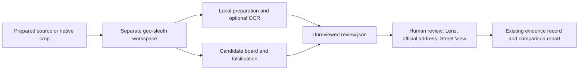

# geo-sleuth bridge / 本地调查工具桥接

[English](#english) · [简体中文](#简体中文)

## English

[Oldcircle/geo-sleuth](https://github.com/Oldcircle/geo-sleuth) is an independent MIT-licensed geolocation skill with image preparation, OCR and a candidate/falsification board. This optional **CLI bridge** adds those tools to Photo Location Workflow without adding a model dependency to the base installation. The web workbench has no geo-sleuth controls yet.



### Install and prepare

Install this project normally, then install [uv](https://docs.astral.sh/uv/getting-started/installation/) and the complete external skill. Codex users can install `skills/geo-sleuth` through skill-installer; the default discovery path is `$CODEX_HOME/skills/geo-sleuth`, or `~/.codex/skills/geo-sleuth` when `CODEX_HOME` is unset. For other environments:

```bash
git clone https://github.com/Oldcircle/geo-sleuth.git tools/geo-sleuth
git -C tools/geo-sleuth checkout 836d70eea196b194391017e6e018e04ccc85aaa4
photo-locate demo --case cases/demo
photo-locate geo-sleuth prepare cases/demo --workspace private/geo-demo --skill-dir tools/geo-sleuth/skills/geo-sleuth
photo-locate geo-sleuth intake cases/demo --workspace private/geo-demo
photo-locate geo-sleuth review cases/demo --workspace private/geo-demo
```

The pinned revision is the integration review baseline, not a claim that arbitrary installed versions have been tested. `--skill-dir` locates a complete skill, not just its scripts. `--uv /absolute/path/to/uv` supports installations outside `PATH`. Preparation invokes local third-party Python code; use a reviewed installation. uv can download Python dependencies on first use. These commands need no OpenAI key or paid model request.

Choose a **new empty workspace outside the case directory**. `prepare` copies only the checksum-verified, metadata-free source. `--asset assets/crops/sign/native.png` selects a native crop; enlarged images are rejected. It initializes `board.json`, exports candidates with uniform priors and records hashes of the input and installed Python scripts in `bridge.json`. Same-name candidates remain distinct through their case IDs. Existing candidates use the placeholder board level `area`; review their geographic level before interpreting the board's coverage or exclusions. New candidates added later require a fresh export or a manual board update.

### Use the board to test alternatives

Inside the exported workspace, use the upstream board commands. This example records an observation, then a test that could disprove a candidate. Substitute an actual exported candidate name for `Candidate A`:

```bash
cd private/geo-demo
uv run ../../tools/geo-sleuth/skills/geo-sleuth/scripts/board.py clue "Three window bays visible" --kind infra --status observed --file input.png
uv run ../../tools/geo-sleuth/skills/geo-sleuth/scripts/board.py falsify "Candidate A" --text "Reject if the facade has only two bays in a comparable view."
uv run ../../tools/geo-sleuth/skills/geo-sleuth/scripts/board.py rank
uv run ../../tools/geo-sleuth/skills/geo-sleuth/scripts/board.py next
```

Return to the project root and run `geo-sleuth review` again to refresh the snapshot. The original `board.json` remains editable. Follow upstream documentation for likelihood ratios, hierarchical candidates, computed exclusions and coverage checks. **A ranking share of 1.0 is not 100% location confidence.** It can simply mean only one candidate was entered.

### Outputs and limits

| File | Purpose |
| --- | --- |
| `input.png` | Exact prepared image copy, with its checksum. |
| `bridge.json` | Provenance, candidate-ID mapping, command arguments, bounded logs and exit status. Contains local tool paths; review before sharing. |
| `board.json` | External hypotheses, observations, exclusions and proposed tests. |
| `intake-*/` | Separate preprocessing runs, edge crops, variants and `intake.md` / `intake.json`. Failed/partial steps remain visible. |
| `review.json` | Unreviewed board report, OCR hypotheses, step status and verification checklist. Refreshed on each review. |

`intake` always passes **`--no-rev`** and defaults to **`--no-ocr`**. No bridge command uploads the image to a reverse-image engine or opens a browser. Optional `intake --ocr` may download model weights and run additional OCR passes; text from upscaled/tiled images remains a hypothesis, especially on plates and signs. Preprocessing variants may alter appearance: they are search aids, not evidence of details in the original pixels. Model/dependency downloads require network access; this is not an offline sandbox for arbitrary upstream code.

The bridge does **not** run upstream reverse-image browser automation, `doctor.py` browser probes, or undocumented Street View endpoints. Google Lens and actual Maps/Street View review remain explicit investigator steps. It does not claim a search, address check or Street View comparison occurred.

`review` checks the case/image association and installed script hashes, uses a fresh upstream report file, and saves suggestions outside the case. **No command in this bridge changes `case.json`, creates reviewed evidence, excludes a case candidate, or raises confidence.** Adopt verified findings through the existing workbench or `candidate` / `evidence` commands, then export the normal HTML/PDF report. `review.json` is a research handoff, not that comparison report.

On a nonzero exit or timeout, inspect `bridge.json` and the run directory. A partial intake is reported as partial even when its process exits successfully. Changed scripts/images require a new workspace; interrupted preparation also requires a new empty workspace. A timeout stops the immediate uv process; upstream subprocess cleanup is not guaranteed. Keep research workspaces private and outside version control.

### Attribution

Upstream: [Oldcircle/geo-sleuth](https://github.com/Oldcircle/geo-sleuth), MIT, copyright 2026 Oldcircle. Reviewed revision: [`836d70e`](https://github.com/Oldcircle/geo-sleuth/tree/836d70eea196b194391017e6e018e04ccc85aaa4). The bridge is original adapter code; upstream code is installed separately and is not vendored in this package. Its own dependency licenses and service terms remain applicable.

## 简体中文

[geo-sleuth](https://github.com/Oldcircle/geo-sleuth) 是 MIT 许可的独立照片定位技能，提供本地预处理、OCR、候选板和反证计划。本项目通过可选**命令行桥接**使用这些工具，基础安装不新增模型依赖，目前网页工作台没有对应按钮。

### 安装与使用

先正常安装本项目和 [uv](https://docs.astral.sh/uv/getting-started/installation/)。Codex 用户可通过 skill-installer 安装完整的 `skills/geo-sleuth`；默认查找 `$CODEX_HOME/skills/geo-sleuth`，未设置环境变量时查找 `~/.codex/skills/geo-sleuth`。其他环境可运行上方安装示例，固定到已检查的 `836d70e` 版本，并传入 `--skill-dir`。版本号表示本次检查基线，不表示任意新版本都已验证。uv 不在 PATH 时传 `--uv /绝对路径/uv`。工具会执行本地第三方 Python 脚本，首次运行可能下载依赖；不需要 OpenAI 密钥或付费模型调用。

三个步骤：

1. `prepare`：将校验通过、已去除 EXIF 的图片和候选导出到案卷目录之外的**全新空工作区**。`--asset` 可选原始分辨率裁切，拒绝放大图。保留同名候选的不同案卷 ID。候选暂以 `area` 层级导入，行政层级与地址仍需核实；后加的候选需要重新导出或手动更新候选板。
2. `intake`：生成边缘裁切和搜索辅助变体。始终禁止反向搜图上传，默认不运行 OCR。显式加 `--ocr` 才启用文字识别，可能下载模型；放大或分块识别出的字仍是待核对假设，模糊车牌不能补字。变体可能改变外观，不能当作原图细节证据。
3. `review`：汇总候选板和 OCR 到独立 `review.json`，标记为 `unreviewed`。执行前检查案卷图片关联、工作副本图片和已安装脚本的哈希。上游排名占比不等于定位正确概率，只有一个候选时也可能显示 1.0。

可在工作区用上方 `board.py clue / falsify / rank / next` 示例记录观察、设计排除测试，再回项目根目录刷新 `review`。示例中的候选名需要替换成真实导出的名字。候选板支持的排除、行政层级和覆盖范围规则，以其上游文档为准。

### 如何接回我们的流程

工具负责整理观察与候选，审阅者继续完成 **Google Lens → 官网名称及完整地址 → 实际街景细节与拍摄月份 → 证据报告**。三个桥接命令均不修改 `case.json`，不自动新增已核对证据、不排除案卷中的候选，也不提高结论等级。确认后通过现有网页或 `candidate / evidence` 命令记录，再导出原有 HTML/PDF；`review.json` 只是研究交接材料。

本桥接没有执行反向搜图、`doctor.py` 浏览器探测或未公开的街景接口，也不会把“未执行”写成“搜过但没有结果”。依赖和模型下载需要网络，它不是隔离任意第三方代码的离线沙箱。

输出含图片、候选板、`intake-*` 运行目录、审阅快照及 `bridge.json`。后者记录参数、退出状态、有限长度日志和本地工具路径，分享前请检查。部分步骤失败会显示 `partial`；整体失败或超时则检查日志，超时只保证停止直接启动的 uv 进程，不保证回收所有上游子进程。脚本或图片变化、准备中断后，使用新的空工作区重新开始。工作区应留在本地并排除版本控制。

上游版权归 2026 Oldcircle，采用 MIT License。本项目仅包含自行编写的适配器，未打包其源代码；上游依赖许可和外部服务条款仍适用。
